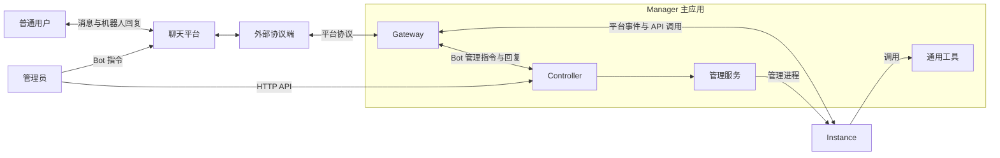

# KiriBot 项目背景

## 文档定位

本文用于同步 KiriBot 的项目定位、组件职责、整体架构和目录结构。

## 项目背景

KiriBot 是面向单一管理员的机器人应用，支持多聊天平台、多协议接入和多种机器人框架。管理员可以统一管理同一个机器人的平台连接与功能。

主应用 Manager 提供管理功能、网关服务和通用工具，为具体的机器人应用提供运行基础。开发者可以选用不同的机器人框架，编写业务功能，并通过 Manager 接入聊天平台、调用通用工具。

## 核心概念

| 组件 | 职责 |
| --- | --- |
| Manager | KiriBot 的主应用，负责管理 Instance，并为其提供平台接入和通用工具。 |
| Controller | Manager 的管理入口，通过 Bot 指令和 HTTP API 两种方式向管理员提供管理功能。 |
| Gateway | Manager 的协议网关。外部协议端与 Instance 都连接到 Gateway，由它在两端之间转发平台事件、API 请求和响应。 |
| 模版 | 可供部署的机器人实现，以代码仓库作为来源。框架名描述其采用的技术，同一种框架可以对应多个模版仓库。 |
| Instance | 基于一份模版源码部署的本地应用。同一份模版可部署为多个 Instance，各 Instance 可维护自己的代码修改、配置和工作目录，由 Manager 独立启停。 |

## 项目架构



## 目录结构

```text
KiriBot/
├── src/kiribot/          # Manager 应用
│   ├── __main__.py       # 启动入口
│   ├── controller/       # HTTP 路由与聊天管理命令
│   ├── services/         # Gateway、Instance、用户与权限服务
│   ├── clients/          # 数据库与子进程访问
│   ├── models/           # 配置与业务模型
│   └── infra/            # 配置加载、日志与浏览器运行环境
├── templates/nonebot2/     # NoneBot2 模版，含源码、依赖锁文件与测试
├── instances/            # 本地部署目录，由管理员按需创建
├── config/               # Gateway 与 Instance 配置示例
├── tests/manager/        # Manager 测试
├── docs/                 # 项目背景、架构和开发约定
├── .env.example          # Manager 环境变量示例
├── pyproject.toml        # Manager 依赖与开发工具配置
└── uv.lock               # Manager 依赖锁文件
```
